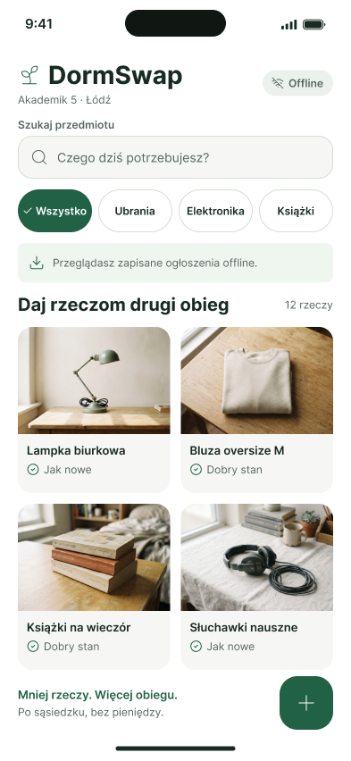
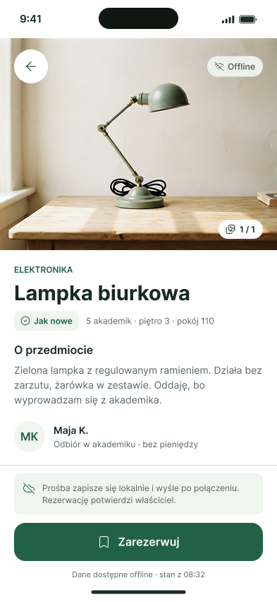
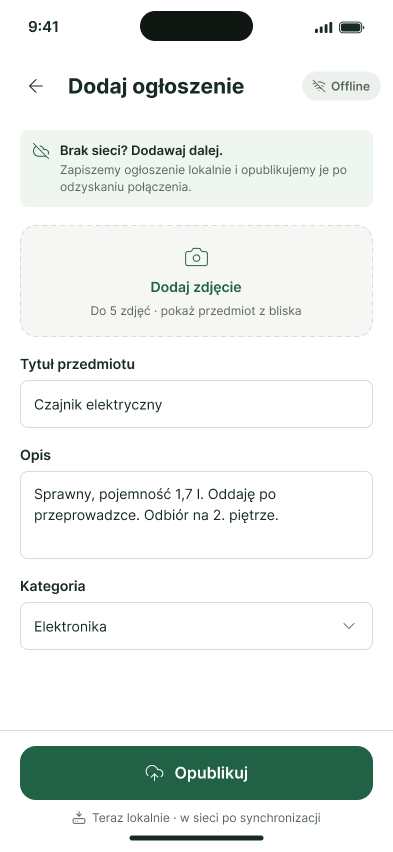

# DormSwap

small mobile application designed to address a clearly defined social
and environmental problem: the waste of usable goods in student dormitories.

---

## M1: Problem and Prototype

### The Social Problem
Students living in dormitories or close to campus constantly need to acquire or get rid of
everyday items like textbooks, kitchenware, small furniture, and electronics. The demand
peaks heavily at the start and end of each semester, especially during move-outs for
international students.

As a result, perfectly usable items often end up in the trash at move-out, while new students
spend money on things they could easily get for free or very cheaply from someone living
in the exact same building.

### Why Existing Options Fail
Current solutions do not solve this problem efficiently:

- **General marketplaces (e.g., OLX):** Built for shipping and dealing with random users across the whole country. They are cluttered with commercial listings and lack the "local community" feel.
- **Dormitory Facebook groups:** Extremely chaotic. Posts get buried quickly, there is no proper search or filtering, and not every student uses Facebook (which is especially true for international students).

### The Solution
A dedicated, local mobile application where students can list and claim items within their specific dormitory community.

### Why a Mobile Application?
- **Instant Photo Capture:** Moving out requires quick action; students can snap a photo with their phone camera and post a listing in under a minute.
- **On-the-go Accessibility:** Students browse or claim items directly while walking through dorm corridors or during move-out days.
- **Offline Reliability:** Network connection in dorm basements or thick-walled rooms is often unstable; a mobile app leverages local persistent storage (Room DB) seamlessly.

---

## Target Group & Scope

### Target User Group
University students living in dormitories and nearby campus housing.

### Core User Stories & Acceptance Criteria

1. **Browsing Items**
  - **User Story:** As a student, I want to browse available items in my dorm so I can find things I need cheaply.
  - **Acceptance Criteria:**
    - The main feed displays a list of available items with a picture, title, category, and condition tag.
    - The user can filter items by category or search by keyword.
    - If no items match the active filter or search, an explicit empty state message is shown.

2. **Listing an Item**
  - **User Story:** As a student moving out, I want to quickly list my items so they don't end up in the trash.
  - **Acceptance Criteria:**
    - The user can access the creation form via a Floating Action Button (+) on the feed screen.
    - Form requires title, category, description, and item condition.
    - Submitting the form with missing required fields shows clear visual validation feedback.
    - After successful submission, the item immediately appears in the feed and persists across app restarts.

3. **Offline Access**
  - **User Story:** As a user without internet access in a specific dorm area, I want to see previously loaded items to check their details.
  - **Acceptance Criteria:**
    - Previously loaded items remain readable when the device is offline.
    - If the user attempts an action requiring connectivity (e.g., refreshing new data), a non-intrusive offline banner/indicator is displayed.

### Out of Scope (Explicitly Excluded from MVP)
To keep the MVP realistic and within the 25h/student budget, the following features are intentionally excluded:
- User registration, authentication, and user profile management.
- In-app messaging/chat backend (contact is handled via external phone link or email).
- Online payments or transaction processing.
- Push notifications.
- Remote custom backend / cloud sync (app relies on local Room DB and synthetic data for networking demonstration).

---

## Architecture & Screen Flow (3 Main Screens)

The app follows the **MVVM** architecture pattern and uses an offline-first strategy with **Room Database** for persistent local storage.

### Screens
1. **Feed Screen:** A dashboard displaying available items with basic filtering.

2. **Item Detail Screen:** Shows full photo, description, condition, and a "Reserve / Contact" action button.

3. **Add Item Screen:** A simple form to list a new item (title, photo, category, description, condition).

### User Flow
1. **Browse:** User opens the app and sees the local `Feed Screen`.
2. **Inspect:** User taps on an item to open the `Item Detail Screen` and view details/contact info.
3. **Contribute:** User taps the floating action button (+) on the Feed to open the `Add Item Screen`, fills out the form, and publishes a new listing.

---

## Accessibility & Risks

### Accessibility Requirements (A11y)
1. **Screen Reader Compatibility:** All interactive UI elements (buttons, form inputs) and images have meaningful `contentDescription` tags for Android TalkBack.
2. **Dynamic Text & Touch Targets:** All text elements support system font scaling without text clipping, and interactive touch targets maintain a minimum size of 48x48 dp.

### Key Project Risks & Mitigation
1. **Risk:** Unstable local data persistence or state loss during screen rotation/app restarts.
  - *Mitigation:* Implement Room DB paired with ViewModel and StateFlow to maintain UI state robustly.
2. **Risk:** Large image files degrading application performance.
  - *Mitigation:* Implement basic image downscaling/compression before saving image paths to local storage.

---

## Tech Stack & Team Responsibilities

### Technology Stack
- **Language & UI:** Kotlin, Jetpack Compose
- **Architecture:** MVVM (Model-View-ViewModel)
- **Local Database:** SQLite Room
- **Asynchronicity & State:** Coroutines & Flow / StateFlow

### Team Responsibilities
- **[DOPISZ: Imię i Nazwisko 1 / Index]:** [DOPISZ: Rola, np. UI Layouts, Feed Screen, Jetpack Compose]
- **[DOPISZ: Imię i Nazwisko 2 / Index]:** [DOPISZ: Rola, np. Room Database, Architecture, State Management]
- **[DOPISZ: Imię i Nazwisko 3 / Index]:** [DOPISZ: Rola, np. Form Validation, Add Item Screen, Navigation]

---

## Prototype & M1 Verification

### UI Prototype
The complete UI prototypes (Figma screens) are stored in the `ui-prototype/` directory and embedded in this README.

### Submission Verification
- **Starter App Status:** Running starter application (Kotlin + Jetpack Compose) configured and tested on emulator / physical device.
- **M1 Submission Commit ID:** `[DOPISZ: TUTAJ_WKLEJ_HASH_COMMITA]` *(np. a1b2c3d)*
- **Instructor Access:** Granted read access to repository instructors (`[DOPISZ: LOGIN_PROWADZACEGO]`).