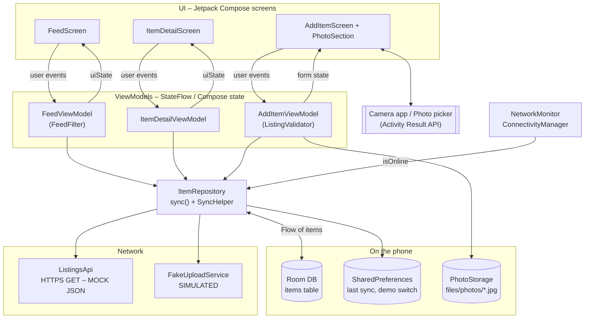

# DormSwap – M2 Working MVP

Android app (Kotlin + Jetpack Compose) where students in one dormitory list things
they don't need and reserve things from other students. M2 = one working flow,
data that survives a restart, a network request with offline/error states and
one mobile capability (camera) with a fallback.

- **Source:** tag `m2` (last commit of the three M2 stage commits)
- **Platform:** Android 7.0+ (minSdk 24, target/compile SDK 37)
- **Design:** Figma file (screens exported to [`design/`](design/)), English version of the M1 prototype

---

## How to build and run

**Android Studio:** open the `IntroMobileSystems` folder, wait for Gradle sync,
choose the `app` configuration and run it on an emulator or a phone.

**Command line** (needs the Android SDK; Gradle downloads JDK 25 for its daemon by itself):

```bash
./gradlew assembleDebug        # APK -> app/build/outputs/apk/debug/app-debug.apk
./gradlew installDebug         # install on a running emulator / phone
./gradlew testDebugUnitTest    # 16 unit tests
```

> The mock API file is read from the `main` branch on GitHub
> (`M2/mock-api/listings.json`). Until this folder is pushed to `main`, refreshing
> shows the error state "Server returned HTTP 404" – the rest of the app works the same.

---

## What to demonstrate (≈ 5 min)

| # | Requirement | Steps |
|---|---|---|
| 1 | **Core task** – list an item and reserve an item | Feed → **+** → take photo → fill title, description, category, condition → **Publish** → item is in *My listings*. Back to *Browse* → open "Desk lamp" → **Reserve**. Tap **Publish** with an empty form to show validation. |
| 2 | **Persistent data** | Swipe the app away (or `adb shell am force-stop com.example.myapplication`) and open it again → new listing (with photo), reservation and likes are still there. |
| 3 | **Network + failure** | Feed refreshes on start (loading bar → "Last updated at …"). Turn on airplane mode → *Offline* chip + "You're currently offline" banner, saved listings still readable. Reserve something offline → "Saved on this phone. It will be sent when you're online." Turn airplane mode off → it syncs by itself. Feed menu ⋮ → **Demo: simulate server error** → Refresh → red banner "Server error 503 (simulated)" with **Retry**. |
| 4 | **Mobile capability + fallback** | Add listing → **Add photo** → *Don't allow* → message + **Choose from gallery** / **Open settings**. Try again → *Allow* → camera opens → photo shown and saved. On a device without a camera the box says "Choose photo" and opens the gallery. The photo is optional, so a listing can always be published. |

Screenshots of these states from the emulator (Pixel 7, Android 15) are in [`screenshots/`](screenshots/):

| File | Shows |
|---|---|
| `01_add_validation` | Publish with empty form → errors under each field + "4 fields need your attention" |
| `02_photo_taken` | Photo from the camera in the form (emulator virtual camera) |
| `03_after_restart_my_listings` | After force-stop and restart: new listing with its photo is still there |
| `04_reserved` | Item reserved by you (stage 1, before sync existed) |
| `05_online_synced` | Feed after a successful download – 5 mock listings added, "Last updated at …" (*tested against a local copy of the mock JSON because it was not pushed yet*) |
| `06_offline_feed` | Airplane mode: Offline chip, offline banner, saved listings still shown |
| `07_offline_reserve_pending` | Reserve while offline → saved on the phone, sent later |
| `08_simulated_server_error` | Demo switch on → "Server error 503 (simulated)" + Retry |
| `09_http_404_before_push` | Real request to GitHub before the JSON was pushed → HTTP 404 handled |
| `10_camera_permission_denied` | Camera permission denied → gallery / settings fallback |
| `11_camera_unavailable` | No camera app available → gallery fallback |

---

## Checklist – what works

| Feature | Status |
|---|---|
| Feed: Browse / My listings / Liked tabs, search, category filter, empty states | ✅ works |
| Item details: reserve, cancel reservation, like | ✅ works |
| Add listing form with validation messages | ✅ works |
| Room database – listings, reservations, likes survive restart | ✅ works |
| Sample data on first start (synthetic) | ✅ works |
| HTTPS request to mock API, loading / success / error states, Retry | ✅ works (success path needs the JSON pushed to `main`, see note above) |
| Offline mode: saved listings readable, offline chip and banners | ✅ works |
| Changes made offline are kept as "pending" and sent automatically when back online | ✅ works (sending is **simulated**) |
| Demo switch to simulate a server error (503) | ✅ works |
| Camera photo (TakePicture + CAMERA permission) | ✅ works (tested on emulator) |
| Permission denied → message, gallery picker, open settings | ✅ works (tested on emulator) |
| No camera on device → gallery picker | ✅ works (tested on emulator started without camera) |
| Photos made smaller (max 1280 px JPEG) before saving | ✅ works |
| Unit tests (validator, feed filter, sync merge, JSON parser, photo sizing) | ✅ 16 tests pass |
| Accessibility basics: content descriptions, 48 dp touch targets, headings, scrollable chip rows for big fonts, error message read by TalkBack | ✅ in code, full check with TalkBack / 200 % font planned for M3 |
| Real backend, other users' devices, owner confirming a reservation | ❌ out of scope (mock / simulated) |
| Chat screen from Figma | ❌ out of scope for M2 (M1 scope excludes messaging) |
| Dark theme | ❌ not done, app uses the light design from Figma |

## Mock services and simulated behaviour

| What | Real / mock | Where in code |
|---|---|---|
| Downloading listings | **Real HTTPS GET** of a **MOCK** static JSON file with **synthetic** data | `data/remote/ListingsApi.kt`, `M2/mock-api/listings.json` |
| Sending new listings / reservations | **SIMULATED** – waits 0.5 s and says OK, nothing is stored on a server | `data/remote/FakeUploadService.kt` |
| Server error 503 | **SIMULATED** with the demo switch in the feed menu | `AppPreferences.simulateServerError` |
| Sample listings and names (Maja K., Ola, …) | **SYNTHETIC** | `data/local/SampleData.kt` |
| "The owner will confirm the reservation" | Only a text – no owner side in M2 | `ItemDetailScreen.kt` |

No real personal data is collected. Photos stay in the app's private storage.

---

## Architecture

MVVM, offline first: **the UI only reads from Room**. The network only writes into Room.



`DormSwapApp` (Application class) creates all of these once (manual dependency
injection) and starts `repository.sync()` on app start and whenever `NetworkMonitor`
reports that the internet is back.

### Example data flow – reserve while offline

1. `ItemDetailScreen` → **Reserve** → `ItemDetailViewModel.onReserveClick()`
2. → `ItemRepository.reserve(id)` → Room: `status = RESERVED, reservedByMe = true, pendingSync = true`
3. Room `Flow` emits → `ItemDetailViewModel.uiState` → screen shows "Reserved by you – saved on this phone"
4. Internet comes back → `NetworkMonitor.isOnline = true` → `DormSwapApp` calls `repository.sync()`
5. `sync()` sends pending items with `FakeUploadService` → `pendingSync = false`, then
   `ListingsApi.fetchListings()` → `SyncHelper.mergeServerItems()` (keeps unsent local changes,
   likes and our reservations) → Room → UI updates by itself.

### Code map

```
app/src/main/java/com/example/myapplication/
├── DormSwapApp.kt / MainActivity.kt
├── core/
│   ├── navigation/AppNavigation.kt     feed → item/{id}, feed → add_item
│   ├── network/NetworkMonitor.kt
│   └── theme/Theme.kt                  colours from Figma
├── data/
│   ├── model/Item.kt                   Room entity + enums
│   ├── local/                          AppDatabase, ItemDao, SampleData, AppPreferences
│   ├── remote/                         ListingsApi, ListingJsonParser, FakeUploadService
│   ├── photo/                          PhotoStorage, PhotoUtils
│   └── repository/                     ItemRepository, SyncHelper
└── ui/
    ├── components/                     OfflineChip, InfoBanner, ItemPhoto, chips
    ├── feed/                           FeedScreen, FeedViewModel, FeedFilter, ItemCard
    ├── details/                        ItemDetailScreen, ItemDetailViewModel
    └── addItem/                        AddItemScreen, PhotoSection, AddItemViewModel, ListingValidator
app/src/test/…                          unit tests
```

## Known limitations (for M3)

- No real server: other phones don't see your listings.
- Sync runs one at a time; a change made during a running sync is sent on the next sync (Refresh or reconnect).
- Old photos are not deleted when a photo is replaced before publishing.
- Accessibility still needs a proper TalkBack + large-font pass and the usability sessions.
