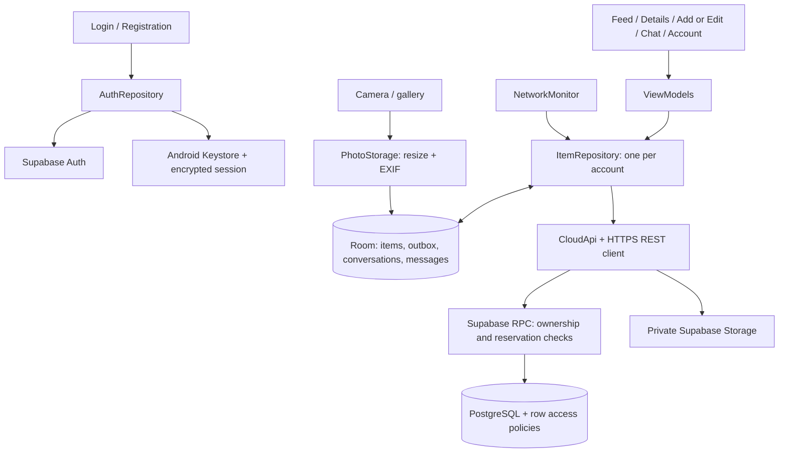

# DormSwap – M3 release candidate

DormSwap helps students in Dormitory 5, Łódź give usable items a second life. It extends the M2 Android app with student accounts, a shared Supabase backend, real uploads, reservations and private conversations. The UI and documentation remain in English, as in M2.

**Delivery status:** Build, unit tests, intermediate-stage builds and live Supabase API checks pass. Live checks cover registration/login, shared listings, reservations, cancellation, private chat and soft deletion. Peer sessions, independent teammate verification, physical-camera/photo-upload and TalkBack checks remain pending. See `testing/supabase-live.txt` and `testing/hosted-device.txt` for actual execution evidence.

## Build and setup

1. Open the repository in Android Studio with Android SDK 37 installed. Keep `sdk.dir` in ignored `local.properties`. The Gradle daemon uses JDK 25 through the existing toolchain configuration.
2. Follow [`backend/README.md`](backend/README.md): run the schema in the team's empty Supabase project, disable signup email confirmation, set minimum password length to 8, and provide the public project URL/key locally.
3. Run:

```bash
./gradlew assembleDebug
./gradlew test
# Optional: with a running Android emulator
./gradlew connectedDebugAndroidTest
```

APK: `app/build/outputs/apk/debug/app-debug.apk`. Install with Android Studio or `adb install -r app/build/outputs/apk/debug/app-debug.apk`.

AGP 9.4.1, built-in Kotlin 2.2.10 / matching Compose plugin, KSP 2.3.13 and Gradle 9.6.0 were kept because the existing configuration builds successfully. Android 7.0+ (minSdk 24); compile/target SDK 37. No production secrets are needed to build. Without public backend configuration the APK opens, but cannot authenticate.

## Functionality

| Flow | Implementation | Verification |
|---|---|---|
| Login / registration, exact `@edu.p.lodz.pl` domain, remembered session, logout | Supabase Auth, encrypted token storage, mandatory login | Validator and invalid-email UI pass; live Auth API passed |
| Feed / My listings / Liked, search, categories, empty state | Room + existing Compose UI | Filter tests pass; authenticated UI pending |
| Add / edit / delete own listings | Durable outbox + checked server RPC | SQL ownership/edit/delete tests pass; phone integration pending |
| Reservations / cancellation | Atomic server row lock; offline requests provisional | SQL conflict tests and merge tests pass |
| Optional camera / gallery photo | Private JPEG ≤1280 px, EXIF correction, private cloud bucket | Photo unit tests pass; M3 camera/upload manual check pending |
| Private text chat linked to listing | Room history, queued sends, 5-second foreground refresh | SQL privacy/idempotency pass; two-device delivery pending |
| Offline, Retry, demo 503, last updated | Account-scoped Room databases and outbox | Merge and persisted-outbox tests pass; network toggling pending |
| Enlarged text / labels | Adaptive feed columns, scrollable forms, labelled controls | Login accessibility-node test passes; 200% and TalkBack pending |

The email rule checks the domain only. With activation emails disabled, it does **not** prove mailbox ownership or student status. Register fictional test accounts for the demo.

## Architecture



The UI reads from Room. Each account has a separate database. A local change and its outbox entry are saved in one transaction. The server records each operation UUID, so a retry cannot duplicate a message or repeat a previously completed mutation. A rejected reservation is replaced by server truth. Rejected changes are shown in Account with Retry/Discard; failed new listing drafts remain local until resolved.

Synchronization runs after login/start, reconnect and local edits, on manual refresh, and every five seconds while a chat screen is visible. There is no background WorkManager service: queued data uploads when the application is running again. New conversations require a connection; existing conversations accept queued messages offline.

## Five-minute demo

Before presenting, complete [`testing/manual-checklist.md`](testing/manual-checklist.md). Use two fictional accounts and the same configured APK on an emulator and a phone.

1. **0:00–0:40:** Explain dormitory reuse; show login and rejection of a non-university address.
2. **0:40–1:40:** Sign in as A, add a synthetic item with an optional photo. Show search / My listings.
3. **1:40–2:40:** Sign in as B on the phone, refresh, reserve A's listing and start a conversation. Reply as A.
4. **2:40–3:30:** Disconnect one device, add a message or listing, show waiting state, reconnect and show delivery. Explain that offline reservations are not guaranteed.
5. **3:30–4:15:** Enable the demo server-error switch, show error and Retry, disable it. Show cancel/edit/delete rules.
6. **4:15–5:00:** Show test results, the reproduced photo bug, honest peer observations and privacy limitations.

## M3 evidence and remaining work

| Required evidence from `org.md` | Location / status |
|---|---|
| Meaningful tests including an edge case | [`testing/README.md`](testing/README.md): 28 unit tests, 3 device tests |
| Reproduced bug, cause, fix, rerun | [`testing/bug-fix.md`](testing/bug-fix.md) + before/after logs |
| Manual scenarios and permission fallbacks | [`testing/manual-checklist.md`](testing/manual-checklist.md), pending authenticated scenarios |
| Two voluntary adult peer sessions and resulting improvements | [`testing/peer-sessions.md`](testing/peer-sessions.md), team to conduct |
| Accessibility / privacy / provenance / risks | [`privacy-and-accessibility.md`](privacy-and-accessibility.md) |
| Three checked AI suggestions | [`../AI_USE.md`](../AI_USE.md) |
| Another teammate builds from README only | [`testing/independent-build.md`](testing/independent-build.md), pending |
| Actual screenshots | [`screenshots/README.md`](screenshots/README.md) |

## Known limitations

- The shared backend passed live API checks. Physical two-device testing is still required. Local SQL tests use small stand-ins for the Auth/Storage schemas; they do not test hosted Auth, Storage HTTP or internet connectivity.
- No password reset, profile editor, push notifications, typing/read receipts, attachments, payments or chat moderation in M3.
- Chat uses foreground polling and downloads history, not realtime sockets or pagination. Suitable for the small demo; large histories need pagination and delta synchronization.
- Last successful server state is visible offline. It can become stale. Unsynced changes are tied to the account and device; uninstalling/clearing app data removes them.
- M2's synthetic local database is not migrated into real user accounts. It remains a historical demo database; M3 creates new account-specific databases and does not publish M2 fixtures.
- Private storage can retain superseded photos and local caches. Manual project cleanup is required; no automatic retention/garbage collection job yet.
- Local logout removes the stored session; it does not guarantee immediate server-side revocation of a token already issued. Supabase token expiration still applies.
- Peer sessions, TalkBack, physical camera/permission tests and independent build have not been fabricated or marked passed.
