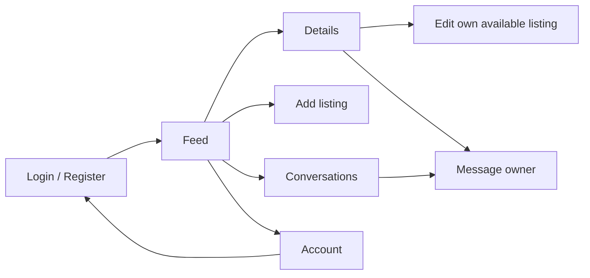

# M3 architecture and screen flow

M3 reuses the M2 light theme and screen conventions; no new Figma exports are required. Architecture is documented in the main M3 README.

All destinations except Login/Register require a session. Account logout removes the session and returns to login; another account gets a different Room database. Deleted listings disappear from Feed but existing conversations stay accessible.
